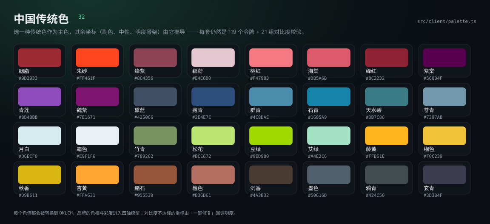
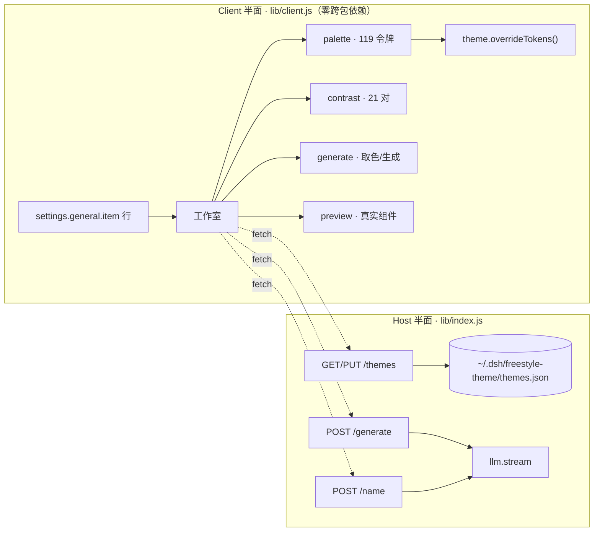

<div align="center">


# dsh-freestyle-theme

**给 DeepSeek Harness 的主题工作室：四轴配色、真实组件预览、对比度体检、32 种中国传统色、分享码。**

[](LICENSE)
[](https://github.com/suzike/dsh-freestyle-theme)
[](docs/design-system.md)
[](tests)
[](#架构)

[安装](#安装) · [能力](#能力) · [界面](#界面) · [配色模型](#配色模型) · [设计规范](docs/design-system.md) · [质量护栏](#质量护栏) · [开发](#开发)

</div>

---

## 为什么做这个

DSH 的界面颜色来自 `--dsw-*` 令牌，壳里定义了 **403** 个；这个插件接管其中决定观感的 **119** 个（107 个 alias + 11 个 specific + `menu-surface-fill`）。令牌一变，聊天、代码块、侧栏、弹层同时变色；其余是结构层与静态调色板，改了只会让主题彼此不自洽，所以刻意不动。

- **四轴建模**：品牌、中性、明度骨架、状态簇，每条轴有自己的彩度上限。
- **看得见才敢点**：预览是用真实令牌画的真实组件，不是色卡拼贴。
- **不牺牲可读性**：21 组前景/背景逐条体检（WCAG + APCA），不达标给一键修复。
- **不留垃圾**：字体、圆角、阴影只影响预览与导出 CSS，从不偷偷改宿主。

## 能力

| | 能力 | 说明 |
| --- | --- | --- |
| 🎛 | 全窗口工作室 | 从设置行一键进入；挂进宿主弹窗内部铺满窗口（不脱离模态子树，输入框照常打字）；`⌘K` 命令面板、`⌘Z` 50 步撤销、焦点陷阱、全键盘可达 |
| 🖱 | 可点的预览 | 侧栏切视图、表单开关、输入框、对比分割线都能真的操作；检查模式逐元素报令牌；模型徽标读宿主当前选择 |
| 🖌 | 整壳一起换色 | 119 个令牌解析成具体颜色后一次写入（120 项），宿主界面/菜单/弹窗同步变色 |
| 🎨 | 四轴配色 | 3 条色彩通道各带色相 / 彩度 / 明度滑杆与独立锁定 |
| 🖼 | 真实组件画布 | 对话、列表、表单三视图；侧栏、气泡、代码块、diff、菜单、toast、tooltip 全用候选令牌上色 |
| 🔍 | 对比与检查 | 半透明分割滑块对比明暗；缩放 50–150%；Inspect 悬停即显示该元素读到的令牌 |
| 👓 | 色觉模拟 | 红 / 绿 / 蓝锥与全色盲四种 SVG 滤镜 |
| ♿ | 对比度体检 | 21 对前景 / 背景，正文 7.0、次要 4.5、控件 3.0，附 APCA Lc，一键按明度收敛修复 |
| 🀄 | 中国传统色 | 32 个色名作起点，副色 / 中性 / 状态簇由它推导 |
| 📚 | 主题库 | 12 套坐标预设 + 32 传统色 + 本地保存；已保存主题可重命名；宿主侧 `~/.dsh/freestyle-theme/themes.json` 持久化 |
| 🖼 | 图片取色 | 中位切分量化 + 饱和度加权；图片不出浏览器，只把坐标送到引擎 |
| ✍️ | 一句话生成 | 有 LLM 走模型，没有就本地 mood 词表兜底，不会卡住 |
| 🔗 | 分享码 | `dsh-freestyle-theme://…` base64url 短键载荷，280 字符内无损往返 |
| 🧱 | 原生手感 | 52 顶栏 / 60 图标轨 / 264 列表 / 320 检查器；4px 栅格、11–17px 字阶 |
| 🎞 | 克制动效 | 120 / 180 / 240 / 320ms 四档，只动合成属性，`prefers-reduced-motion` 全线降级 |

## 界面


| 区域 | 尺寸 | 内容 |
| --- | --- | --- |
| 顶栏 | 52px | 名称 · 明暗 · 撤销 / 重做 · 分享 · 应用到 DSH |
| 图标轨 | 60px | 预设 / 主题库 / 传统色 / 颜色 / 生成 |
| 列表 | 264px | 搜索 + 迷你窗口卡片（浅色 / 深色两张脸） |
| 画布 | 自适应 | 三视图 · 对比滑块 · 色觉模拟 · Inspect · 缩放 |
| 检查器 | 320px | 三通道滑杆 · 排版 · 形状 · 21 对体检 |

宽度不足 1080px 时检查器收成抽屉，画布自动 fit；`Esc` 先关弹层再关工作室。

## 配色模型


| 轴 | 参数 | 彩度上限 | 负责 |
| --- | --- | --- | --- |
| ① 品牌 | `th` `c1` `l1` | 0.37（唯一不封顶的轴） | brand、link、button、focus 环 |
| ② 中性 | `ths` `sc` | 0.012 | 侧栏、输入、菜单的灰度温度 |
| ③ 明度骨架 | `bg` `spread` | — | 4 档 elevation、暗色跨度 ×1.6 |
| ④ 状态簇 | `stateBoost` | 0.16 | success / warn / error / info |
| 外观轴 | `fontPair` `fontScale` `radius` `shadow` | — | **仅预览与导出 CSS** |

```
坐标 ──▶ 4 档 elevation ──▶ 107 alias + 11 specific + 1 surface = 119 令牌 × 明暗两套
```

## 预设与色板

12 套坐标预设覆盖从极端低彩度到高饱和的完整区间，每张卡都是浅色与深色两张脸：


### 中国传统色

轨道第三个按钮：32 个色名，选一个就把它的 OKLCH 色相与彩度放进品牌轴，副色按色相环偏移推导，中性带同一个色相的微量彩度，明度骨架保持不动。于是「胭脂」「青莲」「藤黄」不只是换个主色，整界面都跟着变暖变冷，对比度体检依旧 21/21。



| 色名 | 值 | 色名 | 值 | 色名 | 值 | 色名 | 值 |
| --- | --- | --- | --- | --- | --- | --- | --- |
| 胭脂 | `#9D2933` | 朱砂 | `#FF461F` | 绛紫 | `#8C4356` | 藕荷 | `#E4C6D0` |
| 桃红 | `#F47983` | 海棠 | `#DB5A6B` | 绛红 | `#8C2232` | 紫棠 | `#56004F` |
| 青莲 | `#8048B8` | 魏紫 | `#7E1671` | 黛蓝 | `#425066` | 藏青 | `#2E4E7E` |
| 群青 | `#4C80AE` | 石青 | `#1685A9` | 天水碧 | `#387C86` | 苍青 | `#7397AB` |
| 月白 | `#D6ECF0` | 霜色 | `#E9F1F6` | 竹青 | `#789262` | 松花 | `#BCE672` |
| 豆绿 | `#9ED900` | 艾绿 | `#A4E2C6` | 藤黄 | `#FFB61E` | 缃色 | `#F0C239` |
| 秋香 | `#D9B611` | 杏黄 | `#FFA631` | 赭石 | `#955539` | 檀色 | `#B36D61` |
| 沉香 | `#4A3832` | 墨色 | `#50616D` | 鸦青 | `#424C50` | 玄青 | `#3D3B4F` |

> 只取色相与彩度进入四轴模型，明度由当前模式决定，所以同一色名在浅色与深色下都读得清。

## 对比度


- **21 对**配对：正文 / 次要 / 三级 / 说明、按钮、toast、tooltip、菜单、三态、diff、图标。
- 半透明底先合成到它真正压在的那层，再算比值——不做假透明通过。
- 修复只动明度（`tx → l1 → bg → state`），色相与彩度是你选的，插件不改。
- 发布闸门：**12 预设 × 2 模式 × 21 对**全过才允许发版，最薄的一对也会打印出来。

## 架构




- **单一 `overrideTokens` 出口**：`OverrideOwner` 保证同一来源只有一个覆写生效，关闭工作室即还原本地已应用主题。
- **分包构建**：client bundle 的 `require` 只有 `react` 与 `react/jsx-runtime`，其余能力走 cordis service，构建期有纯净性校验。
- **宿主侧无第三方依赖**：只用 `node:fs` / `os` / `path` / `crypto`，原子写 + 写队列 + 并发安全。

## 遵循的 DSH 插件规范（0.2.1-rc.2）

| 规范 | 本插件的做法 |
| --- | --- |
| 双面包 | `dsh.bundle.patch` 插行 + `dsh.client.platform=web`，`lib/index.js` 与 `lib/client.js` 各司其职 |
| 模块表 | 只用壳暴露的 11 个运行时模块（react、react-dom、cordis、zod、virtual、store、slots、primitives、dockkit…） |
| 服务依赖 | `inject` 只写 `slots`；`theme` / `locale` / `llm` 惰性解析，缺一个不拖垮插件 |
| 清单元数据 | `locale/{zh,en}.json` 的 `meta.title` / `meta.description` 供插件管理页使用 |
| 图标 | `exports["./icon"]` + `package.json.icon`，2 KiB SVG，远低于 256 KiB 上限 |
| 生命周期 | `ctx.effect()` 管样式与覆写；卸载即清理 `<style>`、监听器、覆写 |
| 明暗自适应 | 工作室自身 UI 全用 `--dsw-alias-*` 变量，不写死亮/暗色 |

## 安装

### 1. 克隆并构建

```bash
git clone https://github.com/suzike/dsh-freestyle-theme.git
cd dsh-freestyle-theme
pnpm install
pnpm build            # lib/index.js + lib/client.js
pnpm test             # 59 项单测
pnpm check:tokens     # 令牌 / 对比度 / 分享码闸门
```

### 2. 挂载到 DSH profile

```bash
cp -r . ~/.dsh/plugins/dsh-freestyle-theme
```

```jsonc
// ~/.dsh/profiles/web/package.json
{
  "dependencies": { "dsh-freestyle-theme": "link:../../plugins/dsh-freestyle-theme" },
  "dsh": { "profile": { "bundles": ["dsh-freestyle-theme"] } }
}
```

```powershell
# 让 profile 的 node_modules 认得它（Windows / PowerShell）
New-Item -ItemType Junction -Path ~/.dsh/profiles/web/node_modules/dsh-freestyle-theme `
         -Target ~/.dsh/plugins/dsh-freestyle-theme
```

### 3. 重启 dsh web

设置 → 通用 → **自由主题** → 打开工作室。

> **升级提示**：包名就是加载器 id。从 `@linxin666/freestyle-dsh-theme` 迁过来的，先删旧目录、改 `bundles` 条目，再重启。

## 使用

| 操作 | 效果 |
| --- | --- |
| 设置行缩略图 + 打开 | 进入工作室；缩略图实时反映已应用主题 |
| 设置行「随机」 | 直接抽一套提案并应用 |
| `⌘K` | 命令面板：应用、保存、随机、修复、生成、分享、色觉模拟 |
| `⌘Z` / `⇧⌘Z` | 撤销 / 重做（50 步） |
| `⌘S` | 保存到主题库 |
| `⌘+` / `⌘−` / `⌘0` | 画布缩放 50–150% / 复位 |
| `Esc` | 先关命令面板 / 弹窗，再关工作室 |

## 目录

```
src/
├── index.ts            Host：四条路由 · 原子写 · LLM 代理
├── node.d.ts           仅声明用到的那几个 node: 成员
└── client/
    ├── index.tsx       设置行 + 工作室挂载 + 首帧恢复
    ├── studio.tsx      工作室：画布 / 检查器 / 命令面板 / 分享
    ├── preview.tsx     用真实令牌画的三视图
    ├── palette.ts      四轴 → 119 令牌 · 预设 · 32 传统色 · 分享码
    ├── contrast.ts     WCAG + APCA · 21 对 · 一键修复
    ├── generate.ts     图片量化 / mood 词表 / 候选生成
    ├── styles.ts       工作室与预览的全部样式 · 动效刻度 · 明暗自适应
    ├── locale.ts       zh / en 键对齐的类型化字典
    └── services.ts     本地壳服务声明 · 存储 · fetch
tests/                  59 项：palette / contrast / generate / preview / studio / host / traditional
scripts/check-tokens.mjs 发布闸门：令牌存在性、对比度、分享码往返
scripts/gen-figures.mjs  从同一份数据生成全部配图（自带越界与重叠校验）
docs/design-system.md   设计规范：配色、动效、交互、验收
```

## 质量护栏

```bash
pnpm typecheck     # tsc --noEmit，strict
pnpm test          # node --test "tests/*.test.mjs"
pnpm check:tokens  # 令牌 / 对比度 / 分享码
pnpm build         # 双面包
```

`check:tokens` 做四件事：

1. **令牌存在性** —— 源码引用的每个 `--dsw-*` 都必须在已装主题包里定义（需 `DSH_THEME_CLIENT` 指向 `.../dsh-client-ui-theme/lib/client.js`）。
2. **数量与成对** —— 恰好 119 个（占壳的 30%），且每个都有 light / dark。
3. **对比度闸门** —— 12 预设 × 2 模式 × 21 对，正文类 ≥ 4.5、其它 ≥ 3.0。
4. **分享码往返** —— 编解码后坐标逐项相等。

配图同样有护栏：`node scripts/gen-figures.mjs` 会拒绝任何越界或互相重叠的文字，所以文档里的图不会再次出现压线。

## 开发

```bash
pnpm watch      # tsdown --watch，改完刷新页面
pnpm typecheck  # 类型
pnpm test       # 单测
pnpm build      # 产物：lib/index.js · lib/client.js
node scripts/gen-figures.mjs   # 重新生成 docs/images/*.svg
```

设计约定见 [docs/design-system.md](docs/design-system.md)：色轴与上限、动效刻度、键盘与焦点、验收标准。

## 已知边界

- **材质轴不改宿主**：壳的 theme 服务只接受令牌覆盖，圆角 / 阴影 / 字体族只影响预览与导出的 CSS。
- **浏览器内验证靠 harness**：`scripts/harness.mjs` 在真实浏览器里跑真实 `lib/client.js`；交互（拖拽、滤镜）仍建议装好后手动过一遍。
- **LLM 功能可降级**：没有可用模型时，命名改用「色名 · 度数」，生成改用本地词表。
- **应用后面板会收起**：点「应用到 DSH」会在 220ms 后关掉工作室，避免全窗浮层挡住设置页；想继续调，重开即可，配色已保存。
- **窗口控制条只测了 Windows**：桌面端顶上约 40px 是 Electron 的窗口按钮条（`titleBarOverlay`，由系统画在页面内容之上），工作室会把这条让出来当标题栏：靠 `env(titlebar-area-height)` 与 preload 写的 `html[data-platform]` 判定，浏览器里两者都没有，界面保持贴边。macOS 未实机验证。

## License

[BSD-3-Clause](LICENSE) © dsh-freestyle-theme contributors
