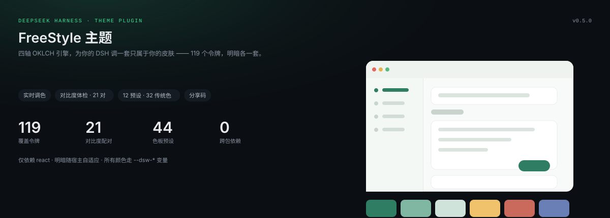
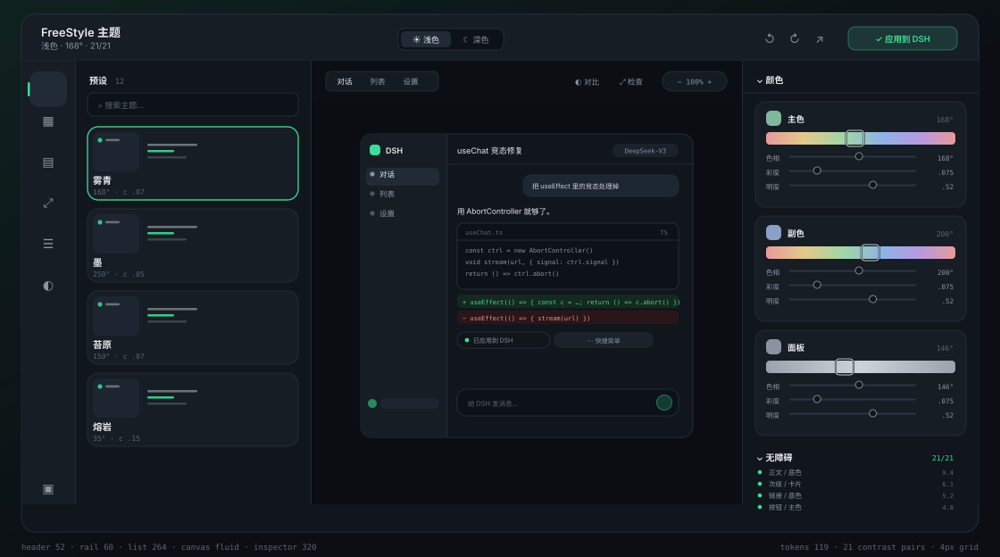
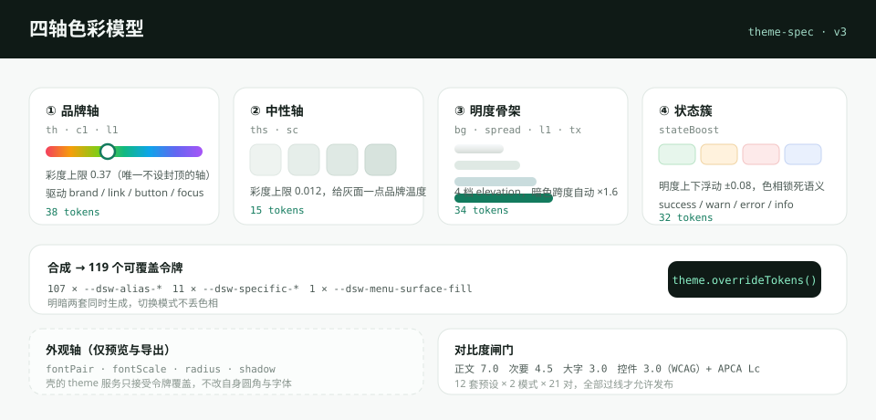
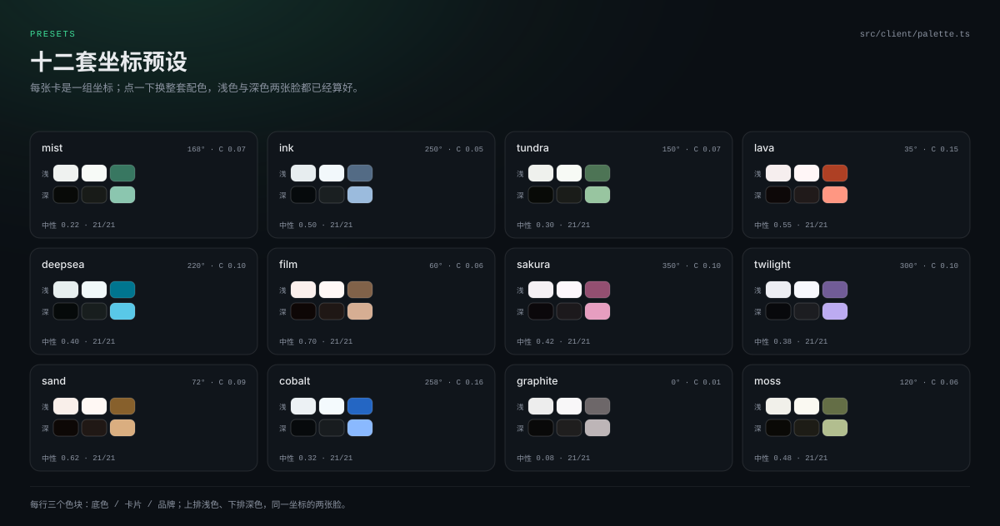
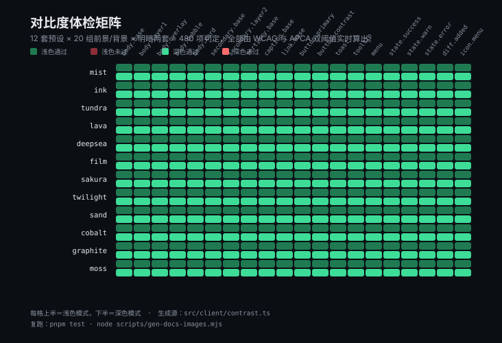
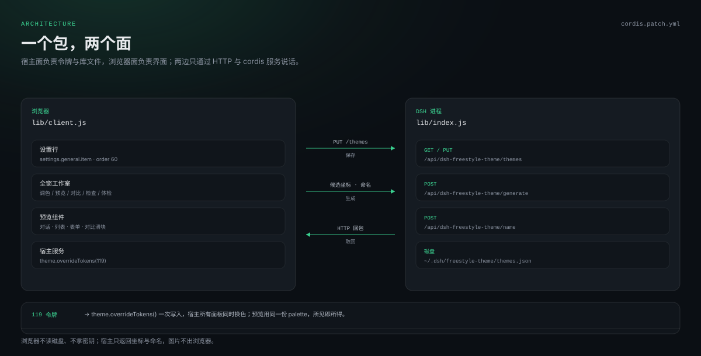
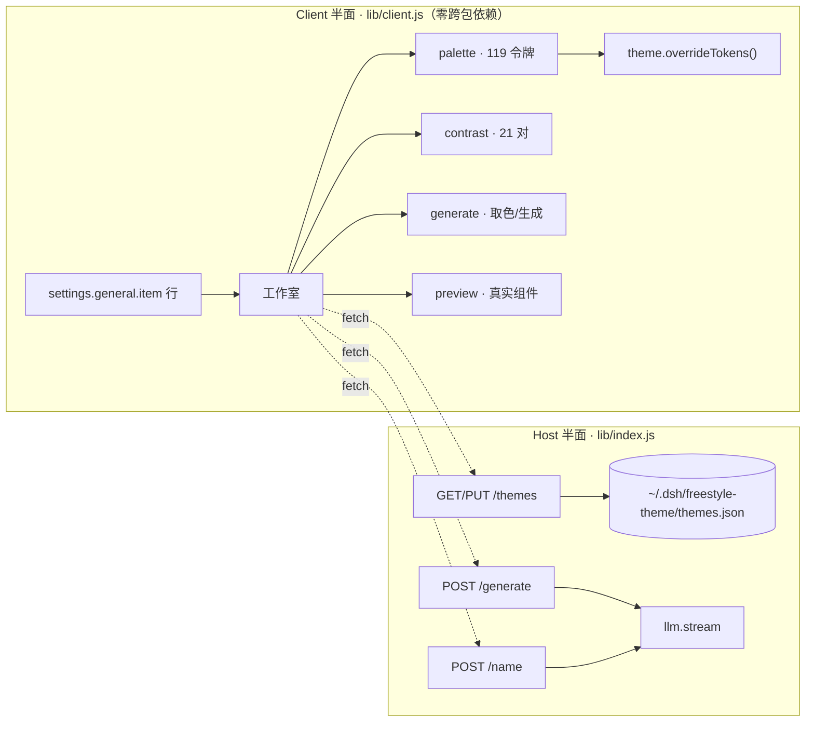

<div align="center">



# dsh-freestyle-theme

**给 DeepSeek Harness 的全窗口主题工作室：四轴配色、真实组件预览、对比度体检、主题库与分享。**

[](LICENSE)
[](https://github.com/suzike/dsh-freestyle-theme)
[](docs/design-system.md)
[](tests)
[](#-架构)

[安装](#-安装) · [能力](#-能力) · [配色模型](#-四轴配色模型) · [设计规范](docs/design-system.md) · [质量护栏](#-质量护栏) · [开发](#-开发)

</div>

---

## 为什么做这个

DSH 的界面颜色来自 `--dsw-*` 令牌，壳里共定义 **403** 个；这个插件接管其中决定观感的 **119** 个（107 个 alias + 11 个 specific + `menu-surface-fill`），令牌一变，聊天、代码块、侧栏、弹层一起变。其余是结构层与静态调色板，改了只会让主题彼此不自洽，所以刻意不动。

- **四轴建模**——品牌、中性、明度骨架、状态簇，每条轴有自己的彩度上限。
- **看得见才敢点**——所有预览都是用**真实令牌**画出来的真实组件，不是色卡拼贴。
- **不牺牲可读性**——21 组前景/背景配对逐条体检（WCAG + APCA），不达标给一键修复。
- **不留垃圾**——材质轴（字体/圆角/阴影）只影响预览与导出 CSS，从不偷偷改宿主。



## ✨ 能力

| | 能力 | 说明 |
| --- | --- | --- |
| 🎛 | **全窗口工作室** | 一键从设置行进入，`⌘K` 命令面板、`⌘Z` 50 步撤销、焦点陷阱与全键盘可达 |
| 🎨 | **四轴配色** | 品牌 / 中性 / 明度骨架 / 状态簇；3 条色彩通道各带色相、彩度、明度滑杆与**独立锁定** |
| 🖼 | **真实组件画布** | 对话、列表、表单三视图，侧栏/气泡/代码块/diff/菜单/toast/tooltip 全用候选令牌上色 |
| 🔍 | **对比与检查** | 半透明分割滑块对比明暗；放大 50–150%；Inspect 模式悬停即显示该元素读到的令牌 |
| 👓 | **色觉模拟** | 红/绿/蓝锥与全色盲四种 SVG 滤镜，先看别人看到的 |
| ♿ | **对比度体检** | 21 对前景/背景，正文 7.0、次要 4.5、控件/图标 3.0，附 APCA Lc；一键按明度收敛修复 |
| 📚 | **主题库** | 12 套坐标预设 + 本地保存；宿主侧 `~/.dsh/freestyle-theme/themes.json` 持久化 |
| 🖼 | **图片取色** | 中位切分量化 + 饱和度加权，**图片不出浏览器**，只把坐标送到引擎 |
| ✍️ | **一句话生成** | 有 LLM 时走模型生成，没有就本地 mood 词表兜底，永远不会卡住 |
| 🔗 | **分享码** | `dsh-freestyle-theme://…` base64url 短键载荷，280 字符内无损往返 |
| 🧱 | **原生手感** | 52px 顶栏 / 60px 图标轨 / 264px 列表 / 320px 检查器；4px 栅格、11–17px 字阶、卡片即迷你窗口 |
| 🎞 | **克制动效** | 120 / 180 / 240 / 320ms 四档，只动合成属性，`prefers-reduced-motion` 全线降级 |

## 🧭 工作室布局

```
┌──────────────────────────────────────────────────────────────────────────┐
│ 名称 · 9.4:1 ▸ 明暗 ▸ 撤销/重做 ▸ 生成 ▸ 分享 ▸ 应用       52px  Esc 关闭 │
├──────┬──────────────┬────────────────────────────────────┬───────────────┤
│ 图标 │ 模板 12 套   │  对话 │ 列表 │ 表单      − 100% +  │ 检查器        │
│ 栏   │ 我的主题     │  ┌──────────────────────────────┐  │ 色彩 ▸ 3 通道 │
│ 60px │ 264px        │  │  真实组件画布（候选令牌上色） │  │ 对比度 21 对  │
│      │              │  └──────────────────────────────┘  │ 排版/圆角/阴影│
│      │              │  对比滑块 · 色觉模拟 · Inspect      │ 一键修复      │
└──────┴──────────────┴────────────────────────────────────┴───────────────┘
```

## 📐 四轴配色模型



| 轴 | 参数 | 彩度上限 | 负责 |
| --- | --- | --- | --- |
| ① 品牌 | `th` `c1` `l1` | 0.37（唯一不封顶的轴） | brand、link、button、focus 环 |
| ② 中性 | `ths` `sc` | 0.012 | 侧栏、输入、菜单的灰度温度 |
| ③ 明度骨架 | `bg` `spread` | — | 4 档 elevation、暗色跨度 ×1.6 |
| ④ 状态簇 | `stateBoost` | 0.16 | success / warn / error / info |
| 外观轴 | `fontPair` `fontScale` `radius` `shadow` | — | **仅预览与导出 CSS** |

```
坐标 ──▶ 4 档 elevation ──▶ 107 alias + 11 specific + 1 surface = 119 令牌 × 明暗两套
```

12 套预设覆盖从极端低彩度到高饱和的完整区间：



## ♿ 对比度



- **21 对**配对，含正文/次要/三级/说明、按钮、toast、tooltip、菜单、三态、diff、图标；不含独立大字档（阈值表预留）。
- 半透明底会先合成到它真正压在的那层，再算比值——不做假透明通过。
- 修复只动明度（`tx → l1 → bg → state`），色相与饱和度是你选的，插件不改。
- CI 闸门：**12 预设 × 2 模式 × 21 对**全部过线才允许发版，最薄的一对也会打印出来。

## 🏗️ 架构





- **单一 `overrideTokens` 出口**：`OverrideOwner` 保证同一来源只有一个覆写生效，关闭工作室即还原本地已应用主题。
- **分包构建**：client bundle 的 `require` 只有 `react` 与 `react/jsx-runtime`，其余能力全部走 cordis service，构建期有纯净性校验。
- **宿主侧无第三方依赖**：`node:fs`/`os`/`path`/`crypto` 四个内置模块，原子写 + 写队列 + 并发安全。

## 🧩 遵循的 DSH 插件规范（0.2.1-rc.2）

| 规范 | 本插件的做法 |
| --- | --- |
| 双面包 | `dsh.bundle.patch` 插行 + `dsh.client.platform=web`，`lib/index.js` 与 `lib/client.js` 各司其职 |
| 模块表 | 只用壳暴露的 11 个运行时模块（react、react-dom、cordis、zod、virtual、store、slots、primitives、dockkit…） |
| 服务依赖 | `inject` 只写 `slots`；`theme`/`locale`/`llm` 全部惰性解析，缺一个不拖垮整个插件 |
| 清单元数据 | `locale/{zh,en}.json` 的 `meta.title/description` 供插件管理页使用 |
| 图标 | `exports["./icon"]` + `package.json.icon`，2098 字节 SVG，远低于 256 KiB 上限 |
| 生命周期 | `ctx.effect()` 管样式与覆写；卸载即清理 `<style>`、监听器、覆写 |
| 明暗自适应 | 工作室自身 UI 全部使用 `--dsw-alias-*` 变量，不写死亮/暗色 |

## 📦 安装

### 1. 克隆并构建

```bash
git clone https://github.com/suzike/dsh-freestyle-theme.git
cd dsh-freestyle-theme
pnpm install
pnpm build            # lib/index.js + lib/client.js
pnpm test             # 50 项单测
pnpm check:tokens     # 令牌 / 对比度 / 分享码闸门
```

### 2. 挂载到 DSH profile

```bash
cp -r . ~/.dsh/plugins/dsh-freestyle-theme
```

```jsonc
// ~/.dsh/profiles/web/package.json
{
  "dependencies": { "dsh-freestyle-theme": "link:../../plugins/dsh-freestyle-theme" },
  "dsh": { "profile": { "bundles": ["dsh-freestyle-theme"] } }
}
```

```bash
# 让 profile 的 node_modules 认得它（Windows 用 PowerShell）
New-Item -ItemType Junction -Path ~/.dsh/profiles/web/node_modules/dsh-freestyle-theme `
         -Target ~/.dsh/plugins/dsh-freestyle-theme
```

### 3. 重启 dsh web

设置 → 通用 → **自由主题** → 打开工作室。

> **升级提示**：包名就是加载器 id。从 `@linxin666/freestyle-dsh-theme` 迁过来的，先删旧目录、改 `bundles` 条目，再重启。

## 🚀 使用

| 操作 | 效果 |
| --- | --- |
| 设置行缩略图 + 打开 | 进入工作室；缩略图实时反映已应用主题 |
| 设置行「随机」 | 直接抽一套提案并应用 |
| `⌘K` | 命令面板：应用、保存、随机、修复、生成、分享、色觉模拟 |
| `⌘Z` / `⇧⌘Z` | 撤销 / 重做（50 步） |
| `⌘S` | 保存到主题库 |
| `⌘+` / `⌘−` / `⌘0` | 画布缩放 50–150% / 复位 |
| `Esc` | 先关命令面板/弹窗，再关工作室 |

## 🗂️ 目录

```
src/
├── index.ts            Host：三条路由 · 原子写 · LLM 代理
├── node.d.ts           仅声明用到的那几个 node: 成员
└── client/
    ├── index.tsx       设置行 + 工作室挂载 + 首帧恢复
    ├── studio.tsx      工作室：画布/检查器/命令面板/分享
    ├── preview.tsx     用真实令牌画的三视图
    ├── palette.ts      四轴 → 119 令牌 · 预设 · 分享码
    ├── contrast.ts     WCAG + APCA · 21 对 · 一键修复
    ├── generate.ts     图片量化 / mood 词表 / 候选生成
    ├── styles.ts       1192 行 CSS · 动效刻度 · 明暗自适应
    ├── locale.ts       zh/en 键对齐的类型化字典
    └── services.ts     本地壳服务声明 · 存储 · fetch
tests/                  50 项：palette / contrast / generate / preview / studio / host
scripts/check-tokens.mjs 发布闸门：令牌存在性、对比度、分享码往返
docs/design-system.md   设计规范：配色、动效、交互、验收
```

## ✅ 质量护栏

```bash
pnpm typecheck     # tsc --noEmit，strict
pnpm test          # node --test "tests/*.test.mjs"
pnpm check:tokens  # 令牌 / 对比度 / 分享码
pnpm build         # 双面包
```

`check:tokens` 会做四件事：

1. **令牌存在性**——源码引用的每个 `--dsw-*` 都必须在已装主题包里定义（需 `DSH_THEME_CLIENT` 指向 `.../dsh-client-ui-theme/lib/client.js`）。
2. **数量与成对**——恰好 119 个（占壳的 30%），且每个都有 light/dark。
3. **对比度闸门**——12 预设 × 2 模式 × 21 对，正文类 ≥ 4.5、其它 ≥ 3.0。
4. **分享码往返**——编解码后坐标逐项相等。

## 🛠️ 开发

```bash
pnpm watch      # tsdown --watch，改完刷新页面
pnpm typecheck  # 类型
pnpm test       # 单测
pnpm build      # 产物：lib/index.js · lib/client.js
```

设计约定见 [docs/design-system.md](docs/design-system.md)：色轴与上限、动效刻度、键盘与焦点、验收标准。

## ⚠️ 已知边界

- **材质轴不改宿主**：壳的 theme 服务只接受令牌覆盖，圆角/阴影/字体族只影响预览与导出的 CSS。
- **浏览器内验证仍待补**：本仓库的渲染断言走 `react-dom/server`，真实浏览器交互（拖拽、滤镜）建议装好后手动过一遍。
- **LLM 功能可降级**：没有可用模型时，命名改用「色名 · 度数」，生成改用本地词表。

## 📄 License

[BSD-3-Clause](LICENSE) © dsh-freestyle-theme contributors
