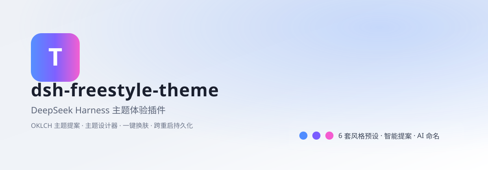

# dsh-freestyle-theme

<div align="center">
  
</div>

<p align="center">
  <a href="https://github.com/suzike/dsh-freestyle-theme/releases"></a>
  <a href="LICENSE"></a>
  <a href="https://nodejs.org"></a>
  <a href="https://github.com/deepseek-ai/DeepSeek-Harness"></a>
</p>

**dsh-freestyle-theme** 是 [DeepSeek Harness (DSH)](https://github.com/deepseek-ai/DeepSeek-Harness) Web GUI 的主题工作室：在**全窗口、实例级预览**的画布上，用 OKLCH 三条色彩轴设计整套界面配色，**所见即所得**地应用到当前会话，跨重启持久化。

---

## ✨ 能力

- 🎨 **三轴 OKLCH** — 品牌色（色相/彩度/明度）、表面轴（背景明度 + 彩度上限）、中性温度（冷↔暖）各自独立，「霓虹感」由彩度封顶算法自动压住
- 🖼️ **实例级实时预览** — 不是色块示意，而是 1:1 复刻的聊天界面 / 列表 / 表单三种视图；侧栏、气泡、代码块、diff、菜单、toast、tooltip 全部用真实令牌绘制
- ↔️ **对比滑块** — 左右分割，拖拽对比「应用前 / 现在」，键盘 ←→ 也能微调分割位置
- 👁️ **色觉模拟** — 红/绿/蓝三型色盲与全色盲的 SVG 滤镜，直接在画布上切换
- 🔍 **令牌巡检** — Inspect 模式点任意部件，浮层显示它实际用了哪些 `--dsw-*` 令牌
- ✅ **无障碍体检** — 20 组关键前景/背景按 WCAG 4.5:1 / 3:1 与 APCA Lc 双重判定；「一键修复」只动明度轴，逼到全部通过为止
- 📚 **12 套坐标预设 + 主题库** — 预设不是换色相，而是自带中性温度、明度梯度与状态簇的完整坐标系；主题库存宿主（`~/.dsh/freestyle-theme/themes.json`）也存本地
- 🖼️ **图片 → 主题** — 客户端在 OKLab 空间做 k-means 聚类取色，权重按像素占比归一，图片不出浏览器
- ✨ **一句话 → 主题** — 宿主 `llm` 生成候选坐标；模型不可用时退回本地情绪映射，不会卡死
- 🔗 **分享码** — 一个 URL 分享整套配色，另可复制 CSS 变量与 JSON
- ⌨️ **键盘优先** — `⌘Z`/`⇧⌘Z` 撤销重做、`⌘K` 命令面板、`⌘S` 存库、`⌘±/0` 缩放、`Esc` 关闭
- 🌗 **明暗自适应** — 119 个令牌明暗各一套；插件自身 UI 只用 `--dsw-alias-*` 变量，不写死任何亮/暗色

---

## 🧭 工作室布局

```
┌─────────────────────────────────────────────────────────────────────────┐
│ 关闭  名称  [对比度 17/20]  ☀ 浅|深 ☾  ↶ ↷            ⌘K  生成  分享  应用 │
├────┬──────────────┬────────────────────────────────────┬─────────────────┤
│ 图 │ 预设 / 主题库 │                                    │ 色彩            │
│ 标 │  搜索         │        实例级预览画布               │  背景/品牌/状态 │
│ 栏 │  12 套卡片    │  （对比滑块 / Inspect / 色觉滤镜）   │ 排版 · 形状     │
│    │               │                                    │ 无障碍          │
└────┴──────────────┴────────────────────────────────────┴─────────────────┘
```

| 区域 | 作用 |
|---|---|
| 顶栏 | 主题名、实时对比度得分、明暗切换、撤销重做、生成、分享、应用 |
| 图标栏 | 模板 / 主题库 / Inspect / 对比 / 图片导入 |
| 左栏 | 12 套坐标预设与主题库卡片，一键载入 |
| 画布 | 聊天 / 列表 / 表单三视图，对比滑块、色觉模拟、缩放 |
| 检查器 | 色彩 / 排版 / 形状 / 无障碍四组，数值支持拖拽微调（`Shift` 加速） |

**边界（诚实说明）**：材质轴（圆角、阴影、字体族、字号比例）只影响**预览与导出的 CSS**——壳的主题服务只接受令牌覆盖，不接受样式注入，所以这三轴不会真正改动 DSH 自身的圆角与字体。想全量改，需要壳开放结构性令牌。

---

## 📐 配色模型

<div align="center">
  
</div>

四轴模型把「好看」拆成可计算的量：

| 轴 | 控制量 | 作用 |
|---|---|---|
| 品牌 | `th` 色相 · `c1` 彩度 · `l1` 明度 | `brand-primary`、主按钮、链接、选中态 |
| 副色 | `th2` · `c2` · `l2` | 侧栏选中/悬停、次级强调 |
| 表面 | `ths` 色相 · `sc` 彩度 · `bg` 明度 | 背景层级、边框、卡片、菜单底 |
| 中性 | `neutralTint` 0…1 | 灰阶继承多少品牌色温（0=纯灰，1=明显染色） |
| 骨架 | `spread` 0.04…0.20 | 最低面到最高面的明度跨度（层级感） |
| 状态 | `stateBoost` 0.2…1.2 | 成功/警告/错误簇的彩度增益 |

派生规则（写进 `src/client/palette.ts`）：彩度封顶（表面 ≤ .030、中性 ≤ .012、边框 ≤ .020、文字 ≤ .030、状态 ≤ .160）；边框永远比它所在的面对比一档而不是复用；暗色模式表面**逐级加亮**而不是加暗；文字与背景的明度差由 `spread` 统一驱动。结果覆盖 **119 个令牌**（107 个 `--dsw-alias-*`、11 个 `--dsw-specific-*` 与 `--dsw-menu-surface-fill`）。

---

## 🏗️ 架构

| 面 | 入口 | 运行位置 | 职责 |
|---|---|---|---|
| Host | `lib/index.js`（`exports["."]`） | DSH 进程 | `GET/PUT /api/dsh-freestyle-theme/themes`（共享主题库）、`POST /generate`（描述→候选坐标）、`POST /name`（配色命名） |
| Client | `lib/client.js`（`exports["./client"]`） | 浏览器 | 设置行 + 全屏工作室；配色计算、取色、对比度体检全部本地完成 |

浏览器半不接触任何模型凭据：生成与命名只提交文字与坐标，凭据留在宿主进程；图片取色完全在浏览器内完成，图片字节不外发。

---

## 🧩 遵循的 DSH 插件规范（0.2.1-rc.2）

| 规范点 | 本插件的做法 |
|---|---|
| 包清单 | `dsh.manifestVersion: 1`；`dsh.bundle.patch` 指向 `cordis.patch.yml`；`dsh.client.platform: "web"` |
| 双面入口 | `exports["."]` 为 ESM 宿主插件，`exports["./client"]` 为浏览器闭包工厂包 |
| 客户端包格式 | 产物即 `window.__ModuleLoader__.load({ id, factory })`，`id` **必须**等于包名；只导出具名 `name / inject / apply`，不导 `default` |
| 平台模块 | 只 `require` 壳冻结模块表内的条目（见 `shared/web-platform.ts`），其余依赖全部内联；跨插件值导入由打包时的纯净性校验直接报错 |
| 设置席位 | 用 `settings.general.item`，只声明 `id` / `order`；该席位不投影 label、不传 props，行自己画标题与摘要 |
| 主题写入 | 只经 `theme.overrideTokens(id, tokens)`，不直接写 CSS 变量，不与壳的主题切换打架 |
| 显示元数据 | 包根 `icon.svg`（`exports["./icon"]`）+ `locale/*.json` 的 `title` / `description`，宿主不执行插件代码即可读出 |
| i18n | 内置 `zh` / `en` 两套字典，经 `locale.register/bind` 注册；AI 提示词按界面语言选择 |
| 构建 | `clientBundle()` 预设；客户端入口 `.tsx`（jsx-runtime 走平台模块） |

---

## 📦 安装

> 需要 **DSH 0.2.1-rc.2 或更新的 0.2.x**、Node `^22.19 || >=24`。

### 1. 克隆并构建

```bash
git clone https://github.com/suzike/dsh-freestyle-theme.git
cd dsh-freestyle-theme
pnpm install
pnpm build
```

产物：`lib/index.js`（Host）、`lib/client.js`（浏览器）、`lib/types/**`，以及 `icon.svg` / `locale/*.json`。

### 2. 挂载到 DSH profile

在 `~/.dsh/profiles/<profile>/package.json` 登记依赖与 bundle：

```json
{
  "dependencies": {
    "dsh-freestyle-theme": "link:../../plugins/dsh-freestyle-theme"
  },
  "dsh": {
    "profile": {
      "bundles": [
        "@deepseek-ai/dsh-base",
        "@deepseek-ai/dsh-web-app",
        "dsh-freestyle-theme"
      ]
    }
  }
}
```

再把插件目录放到 `~/.dsh/plugins/dsh-freestyle-theme`，并在 profile 的 `node_modules` 下建一个指向它的 Junction（Windows：`New-Item -ItemType Junction`）。

> **从 0.2 升级**：包名即加载器 id，`freestyle-dsh-theme` → `dsh-freestyle-theme` 后必须卸载旧包、改 `bundles` 条目、重启，否则壳会报模块缺失。

### 3. 重启 dsh web

重启 DeepSeek Harness 进程并刷新浏览器。

---

## 🚀 使用

1. **设置 → 通用 → FreeStyle 主题** → 打开工作室
2. 左栏点一套预设起步，或直接拖右侧三条色彩轴
3. 画布上开「对比」看前后差异，开「Inspect」看令牌，切色觉模拟确认可辨性
4. 右侧「无障碍」看 20 组体检结果，红项点「一键修复」
5. 「应用」落盘；「分享」导出链接 / CSS / JSON；`⌘S` 存入主题库

---

## 🗂️ 目录

```
dsh-freestyle-theme/
├── src/
│   ├── index.ts              # Host 面：/themes /generate /name 三条路由
│   ├── node.d.ts             # 仅声明用到的三个 node 内建（保持 types: []）
│   └── client/
│       ├── index.tsx         # Client 入口：设置行 + 挂载工作室
│       ├── studio.tsx        # 全屏工作室：顶栏/图标栏/左栏/画布/检查器
│       ├── preview.tsx       # 实例级预览：聊天/列表/表单 + 对比 + 色觉滤镜 + Inspect
│       ├── palette.ts        # OKLCH 引擎、四轴派生、119 令牌、预设、分享码、CSS 导出
│       ├── contrast.ts       # WCAG + APCA 双重体检与明度轴自动修复
│       ├── generate.ts       # 图片量化取色、情绪映射、宿主 AI 候选
│       ├── styles.ts         # 设计系统 CSS（间距/字号/动效刻度/焦点环）
│       ├── locale.ts         # zh / en 字典
│       └── services.ts       # 壳服务的最小本地类型（零跨包依赖）
├── shared/                   # 打包预设：闭包工厂 + 平台模块表
├── tests/                    # palette / contrast / generate 三组单元测试
├── scripts/check-tokens.mjs  # 发版前护栏：令牌名对壳做差集、对比度全量
├── docs/design-system.md     # 设计系统与动效规范
├── locale/  icon.svg  cordis.patch.yml  package.json  tsdown.config.ts  tsconfig*.json
```

## ✅ 质量护栏

```bash
pnpm test          # 39 项单元测试，直接跑 TS 源码
pnpm check:tokens  # 令牌名 / 令牌数 / 对比度 / 分享码
```

`pnpm test` 覆盖四块最容易静默出错的地方：

| 测试 | 守住的东西 |
|---|---|
| `palette.test.mjs` | 119 个令牌成对、明暗层级单调、12 套预设互不重复、分享码无损、恶意输入被 clamp、`presetSpec` 接受 id 或对象 |
| `contrast.test.mjs` | WCAG 21:1 基准、APCA 极性、12 套预设 × 明暗 × 20 组对比全绿、一键修复只动明度且确实收敛 |
| `generate.test.mjs` | OKLCH 参考点、取色权重归一、空/透明图不炸、暗图自动选暗色、无模型时本地候选仍可用 |
| `host.test.mjs` | 三条路由端到端：原子写不留临时文件、坏条目不拖垮整次保存、超长名截断、超大 body 拒绝、模型失败降级为错误码 |

`pnpm check:tokens` 额外把源码里引用到的每个 `--dsw-*` 与已装壳的
`dsh-client-ui-theme/lib/client.js` 做差集——**拼错的令牌不会报错，只会静默丢样式**，
这个差集是唯一能提前发现它的地方：

```bash
DSH_THEME_CLIENT=~/.dsh/.../dsh-client-ui-theme/lib/client.js pnpm check:tokens
```

## 🛠️ 开发

```bash
pnpm typecheck     # tsc --noEmit
pnpm test          # 单元测试（23 项）
pnpm check:tokens  # 令牌与对比度护栏
pnpm build         # 声明 + 双产物
pnpm watch         # 客户端产物监听重建
```

改完产物后同步到 `~/.dsh/plugins/dsh-freestyle-theme/` 并重启 dsh web。

## 📄 License

BSD-3-Clause
